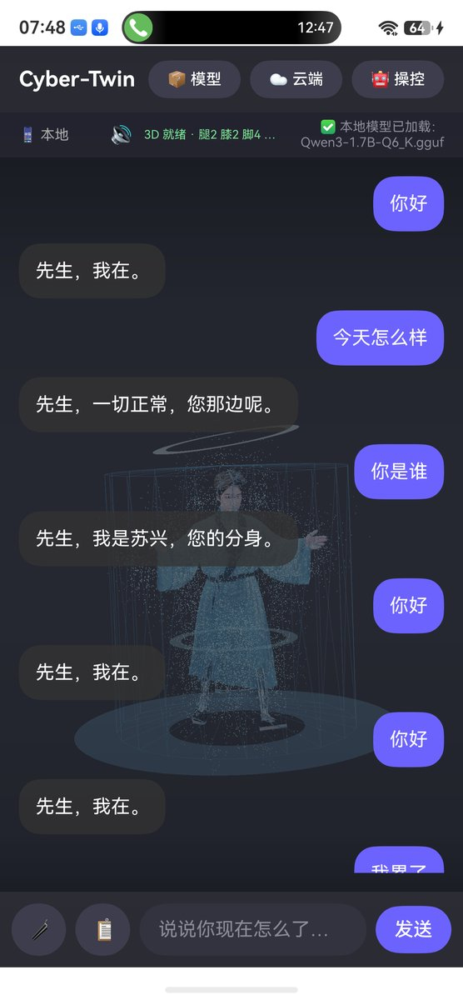
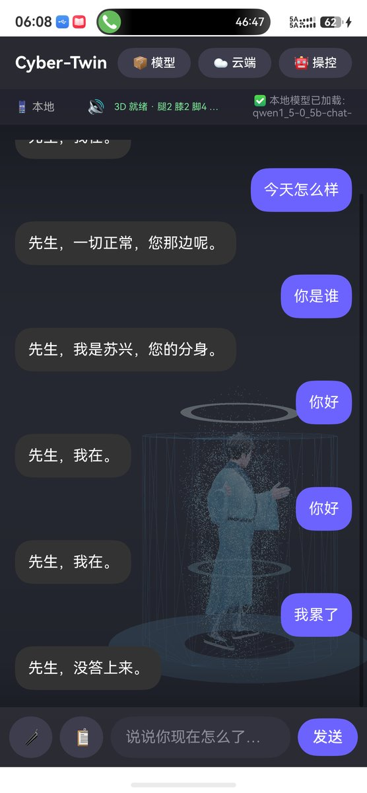

# 苏兴 · HarmonyOS 原生 AI 数字分身

> **English summary** — An on-device AI companion for HarmonyOS, written in ArkTS. All inference runs locally via llama.cpp (cross-compiled to OHOS) with a NAPI bridge, so it works fully offline; when online it can fall back to cloud APIs. Features a 3D avatar rendered with ArkGraphics3D that walks, sits, waves and moves its mouth in sync with speech, plus SQLite-backed memory with BM25 retrieval, a self-evolving persona, and natural-language commands that route to the system share sheet. See the [Known Limitations](#已知限制如实) section for what it deliberately does not do.

一个跑在鸿蒙（HarmonyOS / OpenHarmony）上的**本地优先** AI 分身应用。全部推理在端侧完成，断网可用；联网时自动切换云端模型。

3D 形象站在全屏场景里踱步、呼吸、说话时张口，聊天界面叠在场景之上。

> 个人项目，仍在迭代中。**已知限制都写在文末**，没有隐瞒。

---

## 界面

| 主界面 | 3D 形象与聊天叠加 |
|---|---|
|  |  |

**口型同步**（闭嘴 vs 朗读中，13 倍放大自己的脸部区域）：


**对话指令 → 系统分享**（说「用 QQ 发给李四：文件收到了」，解析出目标后唤起分享面板）：


---

## 功能

| 模块 | 说明 |
|---|---|
| **本地推理** | llama.cpp + NAPI 桥接，Qwen 系列 GGUF 模型端侧运行（0.5B 加载约 285 ms，1.7B 约 400 ms） |
| **端云双模** | 三档降级：云端 API → 本地模型 → 本地词库。连接 10s / 读取 60s / SSE 空闲 30s 三层超时 |
| **3D 形象** | ArkGraphics3D 全屏背景，骨骼驱动行走 / 坐下 / 挥手 / 说话点头，9043 个粒子光场 + 全息装置 |
| **口型同步** | 模型自带 `mouthOpen` 形变目标，按 TTS 振幅驱动；支持切换到带 viseme 的 VRM 模型 |
| **语音** | Core Speech Kit：TTS 朗读 + **离线**语音识别（`mode:1`，不联网） |
| **记忆** | SQLite 持久化，重启不丢；最近 6 轮上下文 + BM25 检索历史（top 3 注入 prompt） |
| **人格** | 固定称用户「先生」；偏好自演化（从"我喜欢/讨厌 X"提取）；情绪三维度（愉悦/能量/亲近）随时间衰减 |
| **主动搭话** | 静默 10 分钟主动开口，每小时上限 2 次，23:00-07:00 静默，不重复最近 3 句 |
| **对话指令** | 说「用 QQ 发给李四：文件收到了」→ 解析出目标应用/收件人/内容 → 唤起系统分享 |
| **剪贴板** | 说「看看我的报错」→ 读取剪贴板内容分析（2000 字截断） |

---

## 技术栈

```
语言      ArkTS（鸿蒙原生）
UI        ArkUI 声明式
3D        ArkGraphics3D（@ohos.graphics.scene）
推理      llama.cpp（交叉编译为 OHOS .so）+ NAPI
语音      @hms.ai.textToSpeech / @hms.ai.speechRecognizer
存储      @ohos.data.relationalStore（SQLite）
人格      Prompt 工程（无微调，全部在 ArkTS 侧拼装）
```

---

## 构建

### 环境
- DevEco Studio 26.0.0.865 或更高
- HarmonyOS SDK API 26（compatibleSdkVersion `26.0.0`）
- 真机或模拟器

### 步骤

```bash
# 1. 配置签名（二选一）
#    A. DevEco Studio → File → Project Structure → Signing Configs → 勾选 Automatically generate signature
#    B. 复制 build-profile.example.json5 为 build-profile.json5，填入你自己的调试证书

# 2. 准备 3D 模型（见下节）
cp <你的模型>.glb entry/src/main/resources/rawfile/Avatar.glb

# 3. 构建
export DEVECO_SDK_HOME="<DevEco>/sdk"
export NODE_HOME="<DevEco>/tools/node"
"<DevEco>/tools/hvigor/bin/hvigorw" --mode module -p product=default assembleHap --no-daemon

# 4. 安装
hdc install -r entry/build/default/outputs/default/entry-default-signed.hap
```

---

## 需要自备的资源

仓库**不包含**以下文件（体积大 / 第三方素材，见 `.gitignore`）：

### 1. GGUF 模型
放在手机上，App 内「📦 模型」按钮导入，会复制到应用沙箱。

推荐：Qwen 系列（0.5B / 1.7B / 3B），Q4 或 Q6 量化。
```
qwen1_5-0_5b-chat-q4_k_m.gguf    约 400 MB
Qwen3-1.7B-Q6_K.gguf             约 1.4 GB
```

### 2. 3D 模型
`entry/src/main/resources/rawfile/` 下需要：
```
Avatar.glb    写实人形，带骨骼（用于行走/坐下/挥手）
nova.glb      可选，VRM 模型，带 viseme 口型（A/I/U/E/O）
```

模型要求：
- glTF 2.0 格式
- 人形骨骼（Hips / Spine / Head / UpperArm / Forearm / Thigh / Calf / Foot）
- 面向 +X 方向（本项目相机在 3/4 前侧）
- 可选：`mouthOpen` morph target（写实版）或 viseme morph target（动漫版）

### 3. llama.cpp 预编译库
`entry/libs/arm64-v8a/` 下需要：
```
libllama.so  libggml.so  libggml-base.so  libggml-cpu.so  libc++_shared.so
```
交叉编译到 OHOS（arm64-v8a）后放入，详见 `README-llama.md`（待补）。

---

## 项目结构

```
entry/src/main/ets/
├── pages/Index.ets              主界面（聊天 + 工具栏 + 面板）
├── common/
│   ├── Avatar3D.ets             3D 场景（骨骼驱动/粒子/装置/口型）
│   ├── AvatarReaction.ets       语义动作映射
│   ├── ModelKit.ets             双模型配置 + 骨骼名映射表
│   ├── Viseme.ets               口型驱动
│   ├── LlamaBridge.ets          本地推理（NAPI 封装）
│   ├── CloudApi.ets             云端 API（SSE 流式 + 三层超时）
│   ├── AiRouter.ets             端云路由
│   ├── Memory.ets               SQLite 记忆 + prompt 拼装
│   ├── Rag.ets                  BM25 检索（中文 bigram，零依赖）
│   ├── Persona.ets              人格（底线 + 偏好演化 + 情绪）
│   ├── Proactive.ets            主动搭话（闸门/模板/冷却）
│   ├── Speech.ets               TTS + 离线 ASR
│   ├── TwinProto.ets            对话指令解析
│   └── WechatShare.ets          系统分享
├── cpp/                         NAPI 桥接（napi_init.cpp + CMakeLists）
└── resources/rawfile/           3D 模型（自备）
```

---

## 已知限制（如实）

| 限制 | 原因 |
|---|---|
| **无法自动操作其他应用** | 华为 HarmonyOS 7.0 移除了三方无障碍入口；`ACCESSIBILITY_EXTENSION_ABILITY` 不在 AGC 可申请 ACL 列表内。代码保留在 `accessibility/`，权限开放即可启用 |
| **系统分享无法指定目标 App** | `ShareControllerOptions` 无 `bundleName` 字段，只能弹面板让用户点 |
| **TTS 拿不到真实音频流** | 离线引擎 `onData` 不回调，口型由按字数估算的音节包络驱动 |
| **BM25 检索换说法就漏** | 无 embedding 模型，纯字面匹配。同义词/语义检索需向量库 |
| **小模型表达能力有限** | 0.5B / 1.7B 即使拿到正确上下文也可能答不好，这是模型能力问题 |
| **写实模型口型幅度小** | 只有一个 `mouthOpen` 形变（约 21mm），远处看不清；带 viseme 的 VRM 模型效果更好 |

---

## 许可

MIT License，见 `LICENSE`。

第三方素材（3D 模型、GGUF 模型）各自遵循其原始许可，本仓库不包含。
